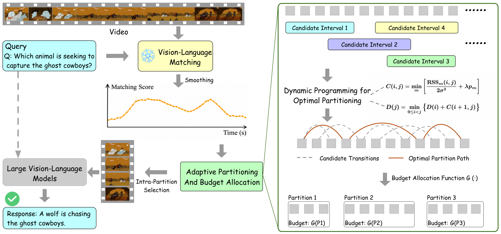

<div align="center">

# APS

### Adaptive Partitioning-Based Frame Selection<br>for Long Video Understanding

**Training-free frame selection guided by query relevance and temporal structure.**

[](docs/installation.md) [](docs/method.md) [](#results) [](https://github.com/Baibaione/APS/actions/workflows/cpu-tests.yml)

[Overview](#overview) · [Quick Start](#quick-start) · [Reproduction](#reproduction) · [Results](#results) · [中文](README.zh-CN.md)

</div>

## Overview

Long videos contain unevenly distributed evidence. APS adapts temporal partitions to the query–frame relevance curve, then distributes a fixed frame budget across those partitions. It requires no training or changes to the answering model.

<p align="center">
  
</p>

1. **Score** candidate frames with a frozen vision-language encoder.
2. **Partition** the relevance curve with complexity-regularized dynamic programming, choosing constant or linear local models.
3. **Allocate and select** frames using partition relevance, temporal extent, and within-partition Top-K ranking.

The selector runs on CPU with NumPy. Evaluation supports **Qwen2.5-VL-7B**, **InternVL3-8B**, and **MiniCPM-V-4** on **Video-MME**, **MLVU**, and **LongVideoBench**. Uniform sampling is included as the reference baseline.

## Quick Start

Try the selector without downloading model weights or benchmark videos:

```bash
git clone https://github.com/Baibaione/APS.git
cd APS
python -m venv .venv
source .venv/bin/activate
python -m pip install -e .
python examples/quickstart.py
```

<details>
<summary><b>Use APS in your own pipeline</b></summary>

```python
from aps import APSConfig, select_frames

selected_frames = select_frames(
    scores,             # One relevance score per candidate, in temporal order
    frame_ids,          # Original video frame indices
    APSConfig(budget=32, alpha=1.0, beta=0.6, penalty=0.5),
)
```

`penalty` is the paper's regularization strength **η**. The CLI also accepts `--eta`. The returned frame indices are sorted chronologically. Pass `return_details=True` to inspect segment boundaries and allocated budgets.

See [method details](docs/method.md) for the objective, parameter definitions, and short-video behavior.

</details>

## Reproduction

### 1. Prepare the environment, models, and data

Follow [installation](docs/installation.md) and [data preparation](docs/data.md). Answering-model downloads use ModelScope by default:

```bash
python scripts/download_models.py --models qwen7b internvl minicpm
```

| Answering model | Frame budget | Benchmarks |
|---|---:|---|
| Qwen2.5-VL-7B | 32 | Video-MME · MLVU · LongVideoBench |
| InternVL3-8B | 32 | Video-MME · MLVU · LongVideoBench |
| MiniCPM-V-4 | 16 | Video-MME · MLVU · LongVideoBench |

The three models share BLIP relevance scores. Qwen and InternVL also share the 32-frame selections; MiniCPM uses the 16-frame selections. The repository includes six reference selection files under `assets/selections/`.

### 2. Select frames

Example for LongVideoBench with 32 frames:

```bash
python -m aps.select \
  --scores cache/longvideobench/blip/scores.json \
  --frames cache/longvideobench/blip/frames.json \
  --annotation data/longvideobench/questions.json \
  --output cache/selected/lvb_aps_k32.json \
  --budget 32 --alpha 1.0 --beta 0.6 --eta 0.5
```

### 3. Evaluate

The experiment launcher handles frame selection and model inference. Start with eight questions from one benchmark:

```bash
python -m aps.experiments --config configs/main_table.json \
  --job qwen25vl_longvideobench --gpus '0' --limit 8 --execute
```

Run the nine full model/benchmark combinations:

```bash
python -m aps.experiments --config configs/main_table.json \
  --gpus '0;1;2;3' --execute
```

Omit `--execute` to preview commands. Add `--methods aps,uniform` to evaluate both methods. Outputs are saved under `outputs/`; rerunning an identical command resumes completed questions. See [evaluation settings](docs/reproducibility.md) for tensor parallelism, memory settings, metrics, and direct inference commands.

### 4. Run ablations

[configs/ablations.json](configs/ablations.json) covers the paper's parameter sensitivity, frame budgets, model scales, encoders, partition variants, and regularization strengths. For example:

```bash
python -m aps.experiments --config configs/ablations.json \
  --axis alpha_beta --gpus '0;1;2;3'
```

See the [ablation guide](docs/ablations.md) for the mapping to the paper's tables and figures.

## Results

Reference question-answering accuracy (%). **MLVU uses micro accuracy in this table**, matching the paper's main results. Macro accuracy is also retained in evaluation outputs.

| Model | Frames | Method | Video-MME | MLVU (micro) | LongVideoBench |
|---|---:|---|---:|---:|---:|
| Qwen2.5-VL-7B | 32 | Uniform | 59.74 | 60.67 | 57.97 |
| | 32 | **APS** | **62.33** | **69.64** | **63.80** |
| InternVL3-8B | 32 | Uniform | 64.63 | 70.19 | 59.31 |
| | 32 | **APS** | **66.85** | **75.21** | **63.58** |
| MiniCPM-V-4 | 16 | Uniform | 56.37 | 52.99 | 54.38 |
| | 16 | **APS** | **57.63** | **61.82** | **58.12** |

Full-precision scores and sample counts are available in [results/reference.json](results/reference.json). See [result definitions](results/README.md) for aggregation and evaluation conditions.

## Repository Guide

| Path | Contents |
|---|---|
| `src/aps/` | Selector, relevance scoring, model inference, and metrics |
| `configs/` | Main experiments and paper ablations |
| `assets/` | Overview figure, reference selections, and input identity checks |
| `docs/` | Installation, data, method, evaluation, and ablation guides |
| `results/` | Compact reference results |
| `examples/` | Standalone CPU example |
| `tests/` | Selection and evaluation protocol tests |

<details>
<summary><b>Development checks</b></summary>

```bash
python -m pip install -e '.[test]'
pytest -q
ruff check src scripts tests
python scripts/check_release.py
python -m build
```

</details>

## Acknowledgements

We thank the developers of BLIP, the supported video-language models, the benchmark datasets, and LMMs-Eval. Third-party code attribution and licenses are preserved in [third_party/NOTICE.md](third_party/NOTICE.md).
