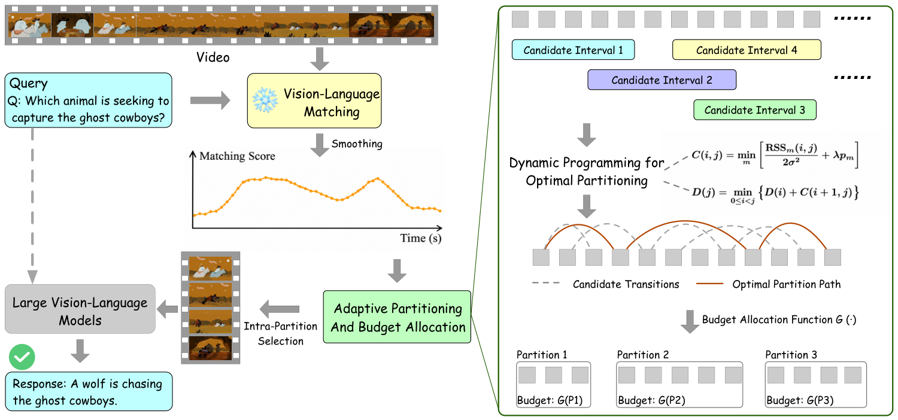

<div align="center">

# APS

### Adaptive Partitioning-Based Frame Selection<br>for Long Video Understanding

**基于自适应区间划分的长视频选帧，无需训练。**

[](docs/installation.md) [](docs/method.md) [](#主要结果) [](https://github.com/Baibaione/APS/actions/workflows/cpu-tests.yml)

[方法概览](#方法概览) · [快速开始](#快速开始) · [实验复现](#实验复现) · [主要结果](#主要结果) · [English](README.md)

</div>

## 方法概览

长视频中的有效证据并非均匀分布。APS 根据问题与候选帧的相关性曲线自适应划分时间区间，再将固定帧预算分配到各区间，无需训练或修改下游答题模型。

<p align="center">
  
</p>

1. **相关性打分**：使用冻结的视觉语言编码器计算候选帧与问题的相关性。
2. **自适应划分**：通过带复杂度正则化的动态规划，联合确定区间边界及常数或线性局部模型。
3. **预算分配与选帧**：结合区间相关性与时间长度分配预算，在各区间内按相关性取 Top-K。

核心选帧仅依赖 NumPy，可在 CPU 上运行。评测支持 **Qwen2.5-VL-7B、InternVL3-8B、MiniCPM-V-4**，覆盖 **Video-MME、MLVU、LongVideoBench**；同时提供 Uniform 均匀采样对照。

## 快速开始

不下载模型或视频即可试跑选帧算法：

```bash
git clone https://github.com/Baibaione/APS.git
cd APS
python -m venv .venv
source .venv/bin/activate
python -m pip install -e .
python examples/quickstart.py
```

<details>
<summary><b>接入自己的流程</b></summary>

```python
from aps import APSConfig, select_frames

selected_frames = select_frames(
    scores,             # One relevance score per candidate, in temporal order
    frame_ids,          # Original video frame indices
    APSConfig(budget=32, alpha=1.0, beta=0.6, penalty=0.5),
)
```

`penalty` 对应论文的复杂度正则化强度 **η**，命令行也支持 `--eta`。输出为按时间排序的原始视频帧编号。使用 `return_details=True` 可查看分区边界与各区间预算。

目标函数、参数含义及短视频处理规则见[方法说明](docs/method.md)。

</details>

## 实验复现

### 1. 准备环境、模型与数据

请参阅[安装指南](docs/installation.md)及[数据准备](docs/data.md)。答题模型默认通过 ModelScope 下载：

```bash
python scripts/download_models.py --models qwen7b internvl minicpm
```

| 答题模型 | 帧预算 | 数据集 |
|---|---:|---|
| Qwen2.5-VL-7B | 32 | Video-MME · MLVU · LongVideoBench |
| InternVL3-8B | 32 | Video-MME · MLVU · LongVideoBench |
| MiniCPM-V-4 | 16 | Video-MME · MLVU · LongVideoBench |

三个模型共享 BLIP 相关性分数。Qwen 与 InternVL 共享 32 帧选帧结果，MiniCPM 使用 16 帧选帧结果；`assets/selections/` 包含六份参考选帧文件。

### 2. 选帧

以 LongVideoBench、32 帧为例：

```bash
python -m aps.select \
  --scores cache/longvideobench/blip/scores.json \
  --frames cache/longvideobench/blip/frames.json \
  --annotation data/longvideobench/questions.json \
  --output cache/selected/lvb_aps_k32.json \
  --budget 32 --alpha 1.0 --beta 0.6 --eta 0.5
```

### 3. 评测

实验入口会依次执行选帧和模型推理。先在一个数据集上试跑八道题：

```bash
python -m aps.experiments --config configs/main_table.json \
  --job qwen25vl_longvideobench --gpus '0' --limit 8 --execute
```

运行全部九组模型与数据集组合：

```bash
python -m aps.experiments --config configs/main_table.json \
  --gpus '0;1;2;3' --execute
```

省略 `--execute` 仅预览命令；添加 `--methods aps,uniform` 可同时评测两种方法。输出位于 `outputs/`，相同命令支持断点续跑。张量并行、显存设置、指标和单独推理命令见[评测说明](docs/reproducibility.md)。

### 4. 消融实验

[configs/ablations.json](configs/ablations.json) 包含论文中的参数敏感性、帧预算、模型规模、编码器、区间划分及正则化强度实验。例如：

```bash
python -m aps.experiments --config configs/ablations.json \
  --axis alpha_beta --gpus '0;1;2;3'
```

各配置与论文图表的对应关系见[消融指南](docs/ablations.md)。

## 主要结果

下表为参考问答准确率（%）。**MLVU 使用 micro 准确率**，与论文主表一致；评测输出同时保留 macro。

| 模型 | 帧数 | 方法 | Video-MME | MLVU（micro） | LongVideoBench |
|---|---:|---|---:|---:|---:|
| Qwen2.5-VL-7B | 32 | Uniform | 59.74 | 60.67 | 57.97 |
| | 32 | **APS** | **62.33** | **69.64** | **63.80** |
| InternVL3-8B | 32 | Uniform | 64.63 | 70.19 | 59.31 |
| | 32 | **APS** | **66.85** | **75.21** | **63.58** |
| MiniCPM-V-4 | 16 | Uniform | 56.37 | 52.99 | 54.38 |
| | 16 | **APS** | **57.63** | **61.82** | **58.12** |

完整精度和样本数量见 [results/reference.json](results/reference.json)，指标定义及测量条件见[结果说明](results/README.md)。

## 目录导航

| 路径 | 内容 |
|---|---|
| `src/aps/` | 选帧、相关性打分、模型推理与指标 |
| `configs/` | 主实验及论文消融配置 |
| `assets/` | 方法图、参考选帧及输入一致性检查 |
| `docs/` | 安装、数据、方法、评测与消融说明 |
| `results/` | 精简的参考结果 |
| `examples/` | 独立 CPU 示例 |
| `tests/` | 选帧与评测协议测试 |

<details>
<summary><b>开发检查</b></summary>

```bash
python -m pip install -e '.[test]'
pytest -q
ruff check src scripts tests
python scripts/check_release.py
python -m build
```

</details>

## 致谢

感谢 BLIP、相关视频语言模型、评测数据集及 LMMs-Eval 的开发者。第三方代码来源及许可证见 [third_party/NOTICE.md](third_party/NOTICE.md)。详细文档和源码注释使用英文。
